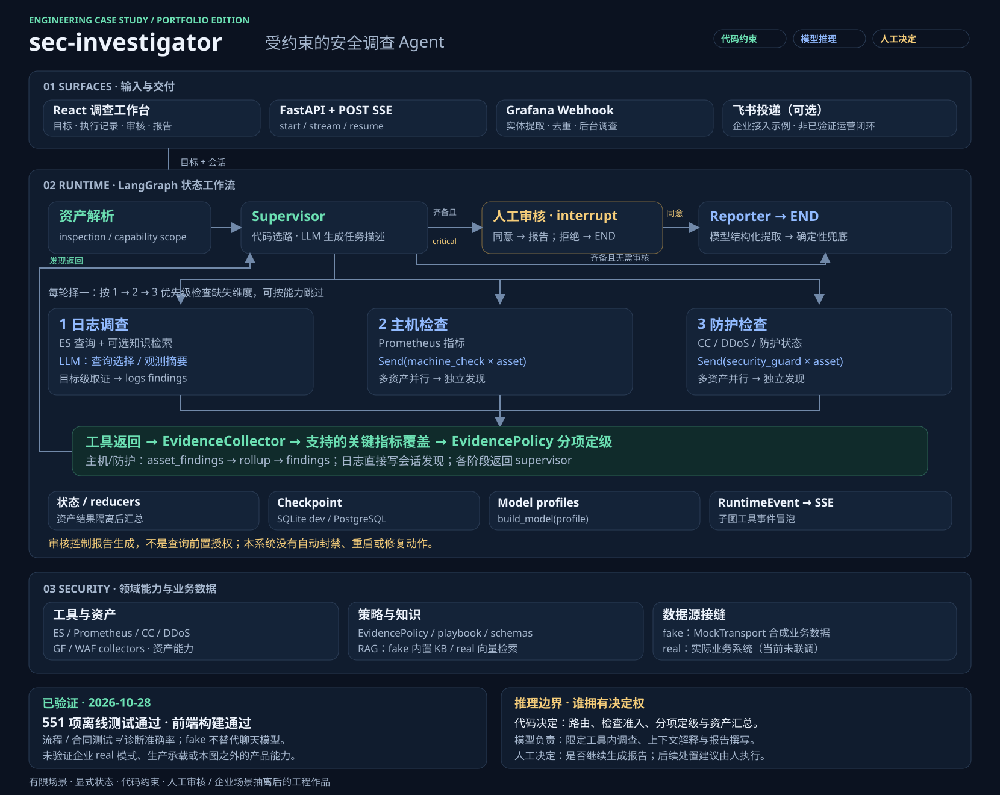
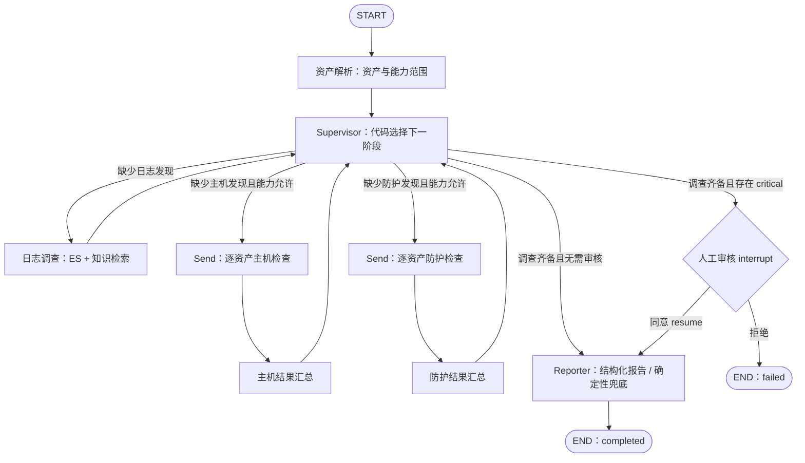

# sec-investigator

**从企业安全运营场景抽离的 Agent 工程重构作品。** 基于 LangGraph，将资产解析、工具取证、分项定级、人工审核和报告生成组织为受约束的状态工作流。

项目源于实习阶段的安全调查场景，当前收敛为作品集版本：展示业务经验如何转化为状态契约、执行边界和工程设计。保留现有合成样例与适配器接口，不继续建设本地企业环境、扩充模拟业务或发展通用 Agent 平台。



## 展示重点

- **代码控制路由**：supervisor 根据已有 findings 和资产能力选择下一阶段；模型补充任务描述。
- **模型在限定工具内调查**：日志、主机和防护 worker 使用各自工具集，受图递归上限及重复/空结果提示约束。
- **关键指标有确定性来源**：`EvidenceCollector` 从实际工具返回中提取支持的数值，覆盖模型抽取的同名字段；`EvidencePolicy` 计算分项风险。
- **多资产隔离后汇总**：同类检查通过 `Send()` 按资产并行，先写 `asset_findings`，再生成会话级 findings。
- **审核后交付报告**：critical 分项触发 checkpoint + interrupt；同意后生成报告，拒绝则结束。没有自动封禁、重启或修复动作。

## 工作流与模型边界



日志 → 主机 → 防护按固定优先级推进，部分阶段可因资产能力跳过。**并行发生在同类检查的多个资产之间**，三个专家阶段不是全程并行。

| 环节 | 模型负责 | 代码 / 人负责 |
|---|---|---|
| 调度 | 生成上下文任务描述 | worker 准入、阶段选择、状态迁移 |
| 取证 | 在绑定工具内选择查询、组织观测摘要 | 工具实现、参数 schema、数据源、运行上限 |
| 结构化发现 | 从分析文本抽取字段 | 已观测关键指标覆盖、分项风险定级、资产汇总 |
| 审核 | 不作审核决定 | critical 触发中断；用户决定继续或结束 |
| 报告 | 综合解释、根因假设、处置建议 | 结构校验、提取降级、最终兜底；建议由人执行 |

总风险与告警状态由分项风险计算；模型生成的报告正文仍可能与证据存在出入，当前没有完整的跨字段一致性校验。

## 阅读入口

- [架构、工作流与推理边界](docs/architecture/agent_runtime_position.md)：设计取舍与当前实现边界。
- [接口与实现索引](docs/REFERENCE.md)：包结构、配置、状态、事件和工具清单。
- [作品集展示与前端方案](docs/portfolio.md)：项目定位、前端选型和结束条件。
- [演示与素材手册](docs/自助演示与素材手册.md)：本地运行和短演示动线。
- [收尾清单](todo.md)：交付事项与已退出范围的扩展。

## 本地运行（可选）

需要 Python ≥ 3.12、uv 和 Node.js/npm。fake 模式替换业务数据源，**模型推理仍需有效凭据或本地模型端点**。

```powershell
uv sync
if (!(Test-Path .env)) { Copy-Item .env.example .env }
```

编辑 `.env`：明确选择 `LLM_PROVIDER` 并填写对应凭据。模板当前默认 `anthropic`；若使用 OpenAI 兼容服务，同时设置 `LLM_PROVIDER=openai`、`OPENAI_API_KEY`、`OPENAI_BASE_URL` 及模型名称。保持 `DATA_SOURCE=fake`。

对于 DeepSeek 官方 `api.deepseek.com` 端点，模型构造层默认使用非思考模式，以兼容结构化输出的强制工具选择；其他 OpenAI 兼容端点不自动应用此选项。

```powershell
cd web
npm ci
npm run build
cd ..
uv run sec-investigator
```

打开 <http://localhost:18230>。FastAPI 在 `web/dist` 存在时托管前端。三个内置样例覆盖爬虫扫描、源站应用故障、源站过载，用于演示流程，不代表通用诊断效果评测。背景见 [incidents.md](docs/incidents.md)。

## 验证范围

```powershell
uv run pytest -q
cd web
npm test
npm run build
```

2026-10-29 本地核验：离线后端测试和前端回归测试通过，TypeScript + Vite 构建通过。测试 Mock 外部端点，不需企业内网或实际模型调用。测试基于本机现有依赖环境，尚未验证全新机器安装。

另使用 DeepSeek 与 fake 数据实跑源站故障样例，覆盖高危调查、人工批准、最终报告和拒绝后的终止状态。运行使用模型 API，可能产生费用；真实模型输出会随运行变化。

仓库已配置 [GitHub Actions](.github/workflows/ci.yml) 运行测试与前端构建；实际 CI 状态以仓库 Actions 为准。事故 replay 中预置 findings 并 Mock 模型的部分验证流程与产物结构，不能据此宣称诊断准确率或线上效果。

## 当前边界

- 工具调用通过唯一 ID 关联，详情可查看完整结果；时间线仍不等同于具备长期存储、检索和访问控制的审计系统。
- 数据不足会在 findings 中标明；模型生成的叙述和根因仍需结合原始证据复核。
- 审批门位于取证之后、报告之前；不审核此前每次查询，不授权自动处置。
- Webhook / 飞书代码保留为接入示例，完整企业部署和 critical 审核运营流程未验证。
- `DATA_SOURCE=real` 需要真实系统和凭据，未在当前环境验证，不作为作品集完结条件。

## 来源与发布

本仓库呈现从企业场景抽离后的重构设计，不将原系统线上运行结果计作当前版本的生产成绩。`docs/origin_data/` 是来源参考；旧评审和旧截图属于历史记录。

当前仓库没有开源许可证文件。公开发布时由作者确认可公开的代码与素材范围、个人贡献说明及授权方式；数据为合成内容，不代表其中的业务标识已完成匿名化。
