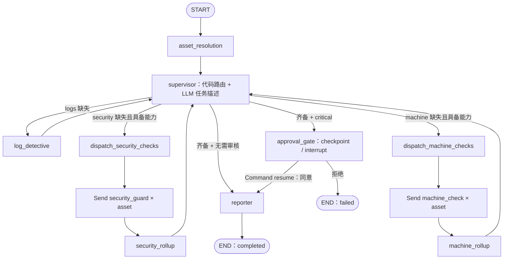

# 架构、工作流与模型推理边界

更新：2026-10-29。本文描述当前代码；设计目标与尚未满足的约束分开说明。

## 项目定位

`sec-investigator` 是从实习阶段企业安全运营场景抽离的 Agent 工程重构作品。关注如何将日志、主机指标、防护状态等领域工具组织为边界明确、状态可管理的调查过程。

本版本以解释已有设计为目标。fake 数据只用于离线工具测试与有限流程演示，不继续扩建本地企业环境，不以生产部署、更多工具或更大模拟数据集作为完结条件。

## 三层职责

| 层 | 当前职责 | 边界 |
|---|---|---|
| `runtime` | LangGraph、状态/reducer、节点、模型 profile、checkpoint、事件 | 不导入 `surfaces`；节点会导入 `security`，不是完全领域无关的内核 |
| `security` | 资产能力、工具/适配器、证据抽取、风险策略、playbook、schema、RAG | 集中领域规则与上游语义 |
| `surfaces` + `web` | FastAPI、SSE、Webhook、飞书、React 展示 | 承接输入和交付，不承担图内模型推理 |

配置和模型构造位于 `runtime`，安全工具和策略会反向读取这些设施。三层体现职责划分，不应宣传为严格单向、无依赖环的整洁架构。

## 实际工作流

1. **资产解析**：域名/IP 解析为 `NodeMachine`，形成 `inspection_scope` 和 `capability_scope`；能力决定可执行的检查。
2. **确定性调度**：依次寻找缺少的 logs、machine、security findings；不具备能力的阶段跳过。LLM 写 `agent_task`，不决定 `next_node`。
3. **有界调查**：worker 使用绑定工具、playbook 和模型 profile；日志阶段包含可选知识检索。
4. **按资产分片**：主机/防护通过 `Send()` 分发，先写 `asset_findings[asset_id]`，rollup 汇总会话级 findings。
5. **审核与报告**：应执行阶段完成后，若分项含 critical 则中断；同意后生成报告，拒绝以 failed 结束。

同类检查内的资产可以并行；三个专家阶段由 supervisor 按序推进。`Send()` 不能证明多租户或分布式水平扩容已验证。

## 模型具体承担什么

| 位置 | 模型输入/输出 | 软件控制的边界 |
|---|---|---|
| supervisor | 资产上下文、已有维度、已确定阶段 → 一句任务指令 | `_next_worker` / `_eligible_workers` 决定路由；此处仍有模型调用依赖 |
| worker | 任务与工具返回 → 查询选择、观测文本 | 绑定工具集、参数 schema、playbook、图递归上限 |
| structured extractor | 分析文本 → Pydantic findings | 确定性关键数值覆盖、分项风险重算 |
| reporter | 会话与资产发现 → 根因假设、摘要、建议、结构化报告 | 提取阶梯、空壳检查、确定性兜底 |

LLM 组织与解释领域信息，不拥有路由权、审核决定权或自动处置权。工具返回是观测材料；模型生成的根因与建议应按解释性输出理解。

## 约束与实际保证范围

### 证据与风险

`EvidenceCollector` 接收已执行工具返回，支持日志错误率/请求数、主机指标和 CC/DDoS 标记等字段。定级用的关键数值来自工具；未采集到的字段不会用模型回忆值填充。没有调用相关工具、无法解析或尚未支持的字段，不会自动成为完整证据。fake 模式下连通性检查返回未检测，不发起 ICMP 探测。

`EvidencePolicy` 计算分项风险，reporter 按分项最高风险确定总风险和告警状态。`evidence_status` 区分 available / partial / insufficient；有覆盖不足且其他分项均为 low 时，总风险至少为 medium。报告正文没有完整数值一致性校验，模型生成的解释与根因仍需复核。

### 工具预算

worker 用 `max_tool_calls * 2 + 1` 设置 ReAct 图递归上限；触及上限可返回部分 findings。重复工具或连续空结果达到阈值后返回停止提示，并非严格取消后续全部调用。

这限制迭代规模，不是精确的工具次数、token 或费用配额。同步 RAG 工具经线程执行并经过同一事件包装器。

### 人工审核

分项风险触发 `interrupt()`，checkpoint 保存中断，`Command(resume=...)` 继续或拒绝。存储由工厂选择 SQLite / PostgreSQL。

审核控制的是**是否继续生成报告**，位于取证之后；不是查询前置授权，也没有审核后封禁/重启链。Webhook 保留后台调查/飞书投递代码，但未形成经验证的企业审核运营闭环。

### 报告降级

`function_calling` → `json_mode` → 原始文本 JSON 解析 → 确定性汇总。前三步尝试模型结果结构化，最后一步基于已有 findings 兜底。这提高输出路径的可用性，不保证诊断准确率。

### 可观察性

RuntimeEvent 经 SSE 和 `subgraphs=True` 转发。前端 `agui.ts` 是项目内部语义映射，没有完整实现 AG-UI wire protocol，也未验证 CopilotKit 互通。

工具调用和结果通过 `call_id` 配对，详情保留完整输出；部分组件仍识别节点名。当前是执行时间线与证据展示，不是完整审计平台或完全解耦的标准协议客户端。

### 资源与模型抽象

工具工厂每次返回独立 `ToolBundle`：默认连接首次使用时创建并在 worker 退出时关闭，注入连接由调用方持有。ES、Prometheus 和 RAG 均支持 `aclose()`；RAG 使用独立连接别名。fake 模式和真实适配器关闭合同已有离线回归，企业 real 模式没有端到端验证。

`build_model(profile)` 隔离聊天模型构造；DeepSeek 官方 OpenAI 兼容端点使用非思考模式以支持结构化输出。RAG embedding 仍直接用 OpenAI SDK，所以模型无关性主要覆盖聊天推理层。

## 验证边界

2026-10-29：现有环境通过离线测试和前端构建；真实模型的 fake 数据演示已执行。没有调用企业业务系统，没有验证 real 模式效果、生产承载能力或诊断准确率。

测试包括策略、工具合同、资产汇总、路由、子图事件和人工中断。事故 replay 的部分测试预注入 findings 并 Mock 报告；审核集成测试经过真实 worker/工具与 fake 数据，但仍替换模型和 ReAct 决策。

## 主要设计取舍

- **固定阶段优先级**：获得可解释、可测试流程，牺牲自由规划和跨阶段任意跳转。
- **确定性数值覆盖**：减少模型记忆数字的漂移，增加工具返回解析与字段维护成本。
- **资产隔离后汇总**：避免并发争用顶层 findings，增加 scope/rollup 的显式设计。
- **LangGraph 作为依赖**：复用状态、checkpoint、interrupt、`Send()`，接受框架约束与升级成本。
- **有限 fake 样例**：提供独立于企业内网的验证入口，不模拟完整企业能力，不代表泛化效果。

作品以这些取舍的实现与说明为中心。生产扩展退出当前完结条件，见 [收尾清单](../../todo.md)。
